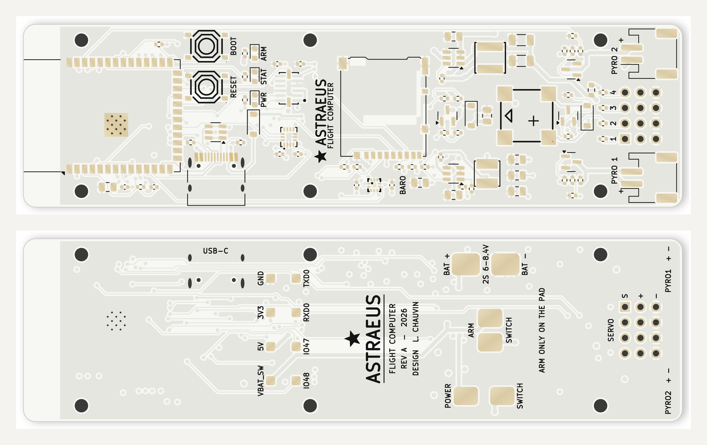
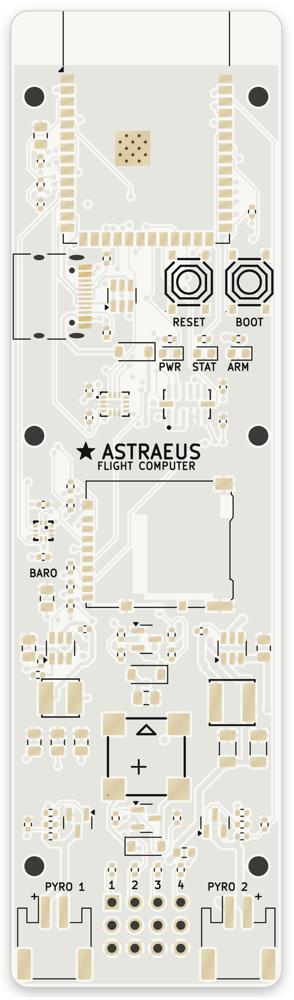
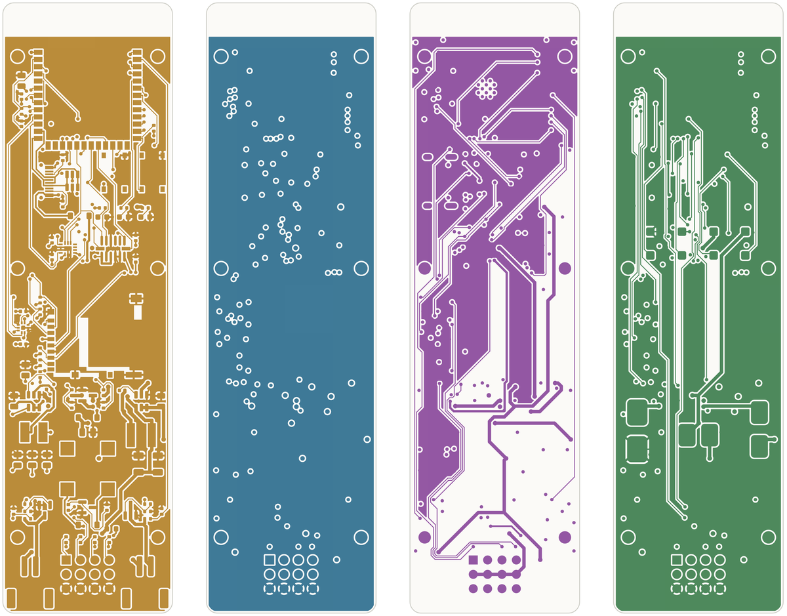
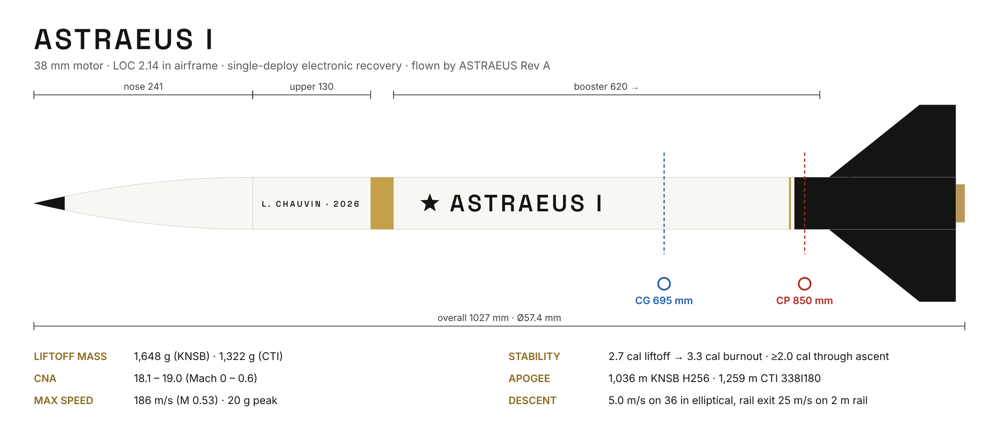
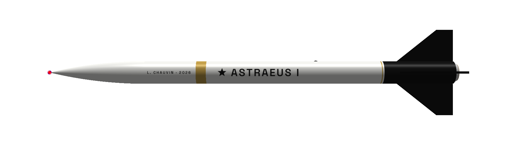
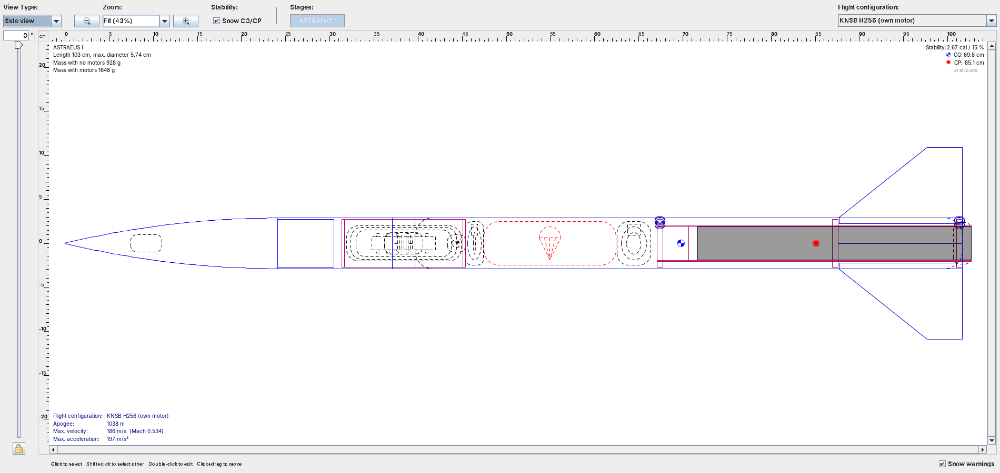

<div align="center">

# ★ ASTRAEUS

**An open-source rocket flight computer, and the rocket built to fly it.**

Designed and built by Louis Chauvin, with Stan Chauvin · Dubai · 2026



`ESP32-S3` · `±200 g sensing` · `2 pyro channels` · `4 servo channels` · `microSD logging` · `fits a 35 mm tube`

</div>

---

## What is ASTRAEUS?

ASTRAEUS is a student project to design, build and fly a complete amateur rocket system from scratch:

1. **ASTRAEUS Rev A**: a custom flight computer that records every flight at high rate, finds apogee, fires the parachute, and is ready for active stabilisation (thrust-vector control).
2. **ASTRAEUS I**: a 1-metre, 54 mm rocket designed around the board, simulated and checked in OpenRocket.
3. **KNSB-38**: our own 38 mm sugar-propellant solid motor, designed in openMotor, with a static test stand.

Everything here (schematics, PCB layout, firmware, rocket design, cutting files) is open, so other students can learn from it, reuse it, or build their own.

> **Status (November 2026):** Rev A boards are being manufactured and assembled by JLCPCB. The breadboard prototype works and the bring-up firmware is written. ASTRAEUS I is fully designed, and the motor is in testing. No flight yet: this README will be updated with real flight data.

---

## Contents

- [The flight computer](#the-flight-computer-astraeus-rev-a)
- [The rocket](#the-rocket-astraeus-i)
- [The motor](#the-motor-knsb-38)
- [Repository layout](#repository-layout)
- [Build it yourself](#build-it-yourself)
- [Safety](#safety)
- [Roadmap](#roadmap)
- [How it was made](#how-it-was-made)
- [License](#license)

---

## The flight computer: ASTRAEUS Rev A



The goal was a board that is **small, rugged and professional**: every chip soldered directly to one PCB, with no stacked modules or breakout boards to shake loose. The white-and-gold look is inspired by Joe Barnard's (BPS.space) AVA board.

### Specifications

| | |
|---|---|
| **Size** | 30 × 108 mm, 1.6 mm, 4 layers. Fits a 35 mm inner-diameter tube |
| **Mass** | ≈ 21 g assembled |
| **Processor** | ESP32-S3 (dual-core 240 MHz, Wi-Fi + Bluetooth, 8 MB flash), native USB-C |
| **Motion sensor** | ST LSM6DSO32: ±32 g accelerometer, ±2000 °/s gyroscope |
| **High-g sensor** | Analog Devices ADXL375: ±200 g accelerometer (motor spikes, ejection shock) |
| **Barometer** | Bosch BMP388 (≈ ±0.5 m relative altitude) |
| **Logging** | microSD on its own SPI bus, so writing never stalls the sensor reads |
| **Pyro** | 2 low-side MOSFET channels, hardware ARM switch, continuity sensing, red ARMED LED |
| **Servos** | 4 channels on a dedicated 5 V / 2 A supply, for thrust-vector control |
| **Status** | Passive buzzer (2.7 kHz), white status LED, green power LED, BOOT and RESET buttons |
| **Power** | 2S LiPo (6.0–8.4 V), reverse-battery protection, separate 3.3 V logic and 5 V servo converters. USB-C alone powers the logic for bench work |

<br clear="right">

### Design decisions

- **Three separate power paths.** Logic (3.3 V), servos (5 V) and pyro each get their own supply, so a stalled servo or a firing e-match can't brown-out the processor mid-flight.
- **Pyro channels that can't fire by accident.** Gate pull-down resistors hold the MOSFETs off during boot and reset. The ARM switch physically disconnects the pyro supply, and the ARMED LED is driven by hardware, not software.
- **Two accelerometers.** The LSM6DSO32 is precise up to ±32 g; the ADXL375 takes over when motor ignition or ejection shocks go past that.
- **4-layer stack-up.** A solid ground plane sits under every sensor for clean measurements. The antenna end is kept free of copper on all four layers so Wi-Fi works through the airframe.
- **Built for flight loads.** Six M2 mounting holes keep the first bending mode near 750 Hz (estimate). Thrust acts in the plane of the board, where it is stiffest. The microSD slot faces sideways, so acceleration along the rocket can't push the card's latch.
- **Status you can hear.** On the launch pad the board is sealed inside the rocket, so it reports by buzzer: one long beep means all checks passed; numbered beeps identify a fault; one beep per channel confirms each connected igniter.

### ESP32-S3 pin map

| GPIO | Function | | GPIO | Function |
|---|---|---|---|---|
| 12 · 11 · 13 | Sensor SPI: SCK · MOSI · MISO | | 40 · 41 | Pyro 1 · 2 gate |
| 10 · 8 | IMU chip select · interrupt | | 1 · 2 | Pyro 1 · 2 continuity sense |
| 14 · 9 | High-g chip select · interrupt | | 6 · 7 · 15 · 16 | Servo 1 – 4 |
| 18 · 17 | Barometer chip select · interrupt | | 21 | Buzzer |
| 36 · 35 · 37 · 38 | microSD SCK · MOSI · MISO · CS | | 42 | Status LED |
| 19 · 20 | USB D− · D+ | | 4 · 5 | Battery · pyro-rail voltage sense |
| 0 | BOOT button (also a user button) | | 47 · 48 · 43 · 44 | Spare GPIO and UART on test pads |

The same map is in [`firmware/selftest/astraeus_pins.h`](firmware/selftest/astraeus_pins.h).

### Layout



*Left to right: top (parts and short signals over a ground fill), inner 1 (solid ground plane), inner 2 (long signal runs with a 3.3 V fill), bottom (remaining signals, solder pads, ground fill).*

Board facts:
- 0.15 mm minimum trace and clearance, 0.3 mm vias.
- Every net routed, with 0 design-rule errors.
- The battery, power switch and arm switch connect to flat solder pads on the underside, because side connectors wouldn't clear the tube wall.

---

## The rocket: ASTRAEUS I



A 54 mm (LOC Precision 2.14") rocket for a 38 mm motor. It flies ASTRAEUS in an electronics bay at its middle, with a single parachute deployed electronically at apogee. Its parts come from standard suppliers (LOC Precision, Fruity Chutes, Aero Pack). The fins and thrust rings are laser-cut from birch plywood, and the electronics sled is 3D-printed.

### Predicted performance (OpenRocket)

| | Own KNSB motor (estimated curve) | Cesaroni 338I180 (first flight) |
|---|---|---|
| Apogee | ≈ 1,040 m | ≈ 1,260 m |
| Top speed | 186 m/s (Mach 0.53) | 230 m/s |
| Peak acceleration | 20 g | 16 g |
| Stability | 2.65 → 3.2 calibers (≥ 2.0 through ascent) | 3.3 → 4.1 calibers |
| Normal-force coefficient CNα | 18 – 19 | 18 – 19 |
| Rail exit speed (2 m rail) | 25 m/s | 22 m/s |
| Descent rate | 5.0 m/s | 4.5 m/s |
| Liftoff mass | 1,648 g | 1,322 g |

### Airframe

| | |
|---|---|
| **Length / diameter** | 1,027 mm / 57.4 mm |
| **Nose cone** | LOC PNC-2.14 ogive, with 50 g of nose weight for stability margin in crosswinds |
| **Avionics bay** | LOC EB-2.14 coupler with a gold switch band. Holds ASTRAEUS, a 2S 450 mAh LiPo, the power and arm switches, and the ejection charge wells |
| **Fins** | 4 × clipped delta, 3/16" (4.8 mm) birch aircraft plywood, through-the-wall. Flutter speed ≈ 300 m/s, about 1.5× the rocket's top speed |
| **Motor mount** | 38 mm × 14", three centering rings, Aero Pack screw-on retainer |
| **Recovery** | 36" Fruity Chutes elliptical, 15 ft Kevlar shock cord, Nomex blanket. Primary charge at apogee, back-up 1.5 s later |

<p align="center">
<br>
<br>
<em>OpenRocket's own 3D and cut-away views: e-bay, packed parachute, shock cord, motor and nose weight, all to scale.</em>
</p>

---

## The motor: KNSB-38

A 38 mm solid motor using KNSB (potassium nitrate and sorbitol "sugar" propellant) in four BATES grains. It sits on the H/I-class boundary, at roughly 300–330 N·s total impulse over about 1.2 s. The aluminium casing and steel nozzle were designed in CAD, and the internal ballistics were simulated in openMotor. A vertical static test stand with a load cell is used to measure the real thrust curve before any flight.

> The thrust curve in [`rocket/LChauvin_KNSB38.eng`](rocket/LChauvin_KNSB38.eng) is an **estimate**. It will be replaced with the measured static-test curve.

---

## Repository layout

```
astraeus/
├── hardware/
│   ├── kicad/            KiCad 7 project (board, footprint library, layout scripts)
│   └── fabrication/      Gerbers, drill, BOM and placement files for JLCPCB, 1:1 print
├── firmware/
│   ├── selftest/         Bring-up test for Rev A + astraeus_pins.h
│   └── breadboard-prototype/   v1.1 logger used on the breadboard prototype
├── rocket/               OpenRocket design, motor curve, laser-cut fins (DXF), decals
└── images/
```

---

## Build it yourself

### 1. Order the board

The files in [`hardware/fabrication`](hardware/fabrication) are ready for JLCPCB with factory assembly:

| Setting | Value |
|---|---|
| Layers | 4, 1.6 mm, FR-4 |
| Colour | White solder mask, black silkscreen |
| Surface | ENIG (flat gold pads for the tiny LGA sensors) |
| Copper | 1 oz outer, 0.5 oz inner |
| Vias | Tented or plugged, 0.3 mm minimum hole |
| Assembly | Top side, Standard PCBA. Upload `ASTRAEUS_BOM_JLCPCB.csv` and `ASTRAEUS_CPL_JLCPCB.csv` |

In the 3D placement preview, check that each chip's pin-1 dot matches the board marking. You solder the 3 × 4 right-angle servo header and the wires yourself.

### 2. First power-up

1. Plug in USB-C, with no battery. The green PWR LED should light and a serial port should appear.
2. In the Arduino IDE, choose *ESP32S3 Dev Module*, *USB CDC On Boot: Enabled*, *Flash 8 MB*. Upload [`astraeus_selftest.ino`](firmware/selftest/astraeus_selftest.ino).
3. Listen: a rising chirp, then **one long beep** means every chip answered. Short beeps identify a fault: 1 IMU, 2 high-g, 3 barometer, 4 SD card.
4. Serial commands:
   - `r` reads the sensors
   - `v` reads the battery voltage
   - `s` sweeps the servos
   - `FIRE1` / `FIRE2` pulse a pyro channel, **bench test with an LED + 1 kΩ resistor only**

### 3. Build the rocket

Open [`rocket/ASTRAEUS_I.ork`](rocket/ASTRAEUS_I.ork) in OpenRocket 24.12 or later. First copy the `.eng` file into OpenRocket's ThrustCurves folder, so the custom motor loads. Then:
- Laser-cut the fins and thrust rings from [the DXF](rocket/ASTRAEUS_I_fins_laser_4.8mm_ply.dxf) in 4.8 mm birch plywood.
- Print the decals at 100 % from [the decal sheet](rocket/ASTRAEUS_I_decal_sheet_1to1.pdf).

---

## Safety

- **Arm only on the launch pad.** Never connect an igniter to an armed board indoors or on a bench.
- **Ground-test the ejection charges** with the rocket fully packed before the first flight.
- **Static-test home-made motors** before flying them, and fly only with a club or national rocketry body, following its rules. Black powder, e-matches and rocket motors are regulated in many countries, including the UAE.
- LiPo batteries: charge with a proper balance charger, never unattended.

---

## Roadmap

- [x] Breadboard prototype: ESP32 + barometer + IMU + microSD logging
- [x] ASTRAEUS Rev A designed, ordered, factory-assembled
- [x] ASTRAEUS I rocket designed and simulated
- [ ] Rev A bring-up and bench tests
- [ ] Flight firmware: all three sensors, high-rate logging, flight state machine, buzzer status
- [ ] Motor static fires and measured thrust curve
- [ ] First flight (commercial motor), then flights on our own KNSB motor
- [ ] Electronic deployment validated in flight
- [ ] Attitude estimation and thrust-vector control

---

## How it was made

Design tools: KiCad 7 for the schematic and PCB (autorouted with Freerouting, checked with KiCad DRC), OpenRocket for the rocket, openMotor for the motor, Arduino and ESP-IDF for the firmware. AI assistance (Claude) was used during design, simulation and documentation; every design decision was reviewed, and the hardware is built and tested by us.

---

## License

- **Hardware** (KiCad files, fabrication files, rocket design): [CERN-OHL-S v2](https://ohwr.org/cern_ohl_s_v2.txt)
- **Firmware:** [MIT](https://opensource.org/license/mit)

You're welcome to build, modify and share ASTRAEUS. Please credit the project and share your improvements.

---

<div align="center">

★ **ASTRAEUS** · L. Chauvin · 2026

*Named after Astraeus, the Titan of the stars and the dusk winds.*

</div>
